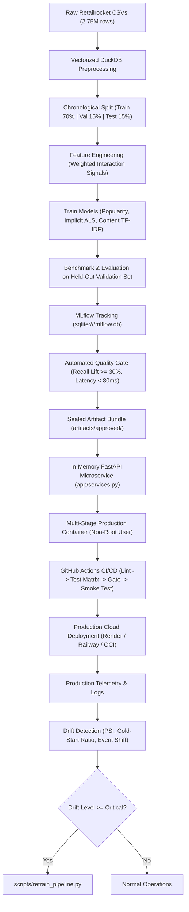

# 🛒 Enterprise E-Commerce Product Recommendation System with MLOps

[](https://www.python.org/)
[](https://fastapi.tiangolo.com/)
[](https://www.docker.com/)
[-success.svg?logo=pytest)](https://docs.pytest.org/)
[](https://mlflow.org/)
[](https://github.com/features/actions)
[](https://opensource.org/licenses/MIT)

An enterprise-grade, portfolio-ready **E-Commerce Product Recommendation Engine and MLOps Microservice** built on the real-world **Retailrocket Recommender System Dataset** (2.75 million customer interaction events).

Designed from first principles to mirror production recommender architectures at Amazon, Netflix, and Shopify: combining **Implicit Alternating Least Squares (ALS) Collaborative Filtering**, **Content-Based TF-IDF Item Similarity**, and a **Weighted Popularity Baseline** into a unified, low-latency ($< 5\text{ ms}$) hybrid serving engine with automated cold-start fallback, containerized deployment, CI/CD gating, and continuous data drift monitoring.

---

## 📑 Table of Contents

- [Business Problem & Architecture](#-business-problem--architecture)
- [Model Benchmark & Performance Comparison](#-model-benchmark--performance-comparison)
- [System Architecture & Workflow](#-system-architecture--workflow)
- [Repository Structure](#-repository-structure)
- [Quickstart Guide](#-quickstart-guide)
  - [1. Environment Setup](#1-environment-setup)
  - [2. Running the Automated Test Suite](#2-running-the-automated-test-suite)
  - [3. Running the REST API Locally](#3-running-the-rest-api-locally)
  - [4. Docker Containerization](#4-docker-containerization)
- [Interactive API Endpoints](#-interactive-api-endpoints)
- [MLOps Lifecycle & Governance](#-mlops-lifecycle--governance)
  - [MLflow Experiment Tracking & Model Registry](#mlflow-experiment-tracking--model-registry)
  - [Automated Model Quality Gate in CI/CD](#automated-model-quality-gate-in-cicd)
  - [Production Drift Monitoring & Retraining](#production-drift-monitoring--retraining)
- [Phased Engineering Methodology](#-phased-engineering-methodology)
- [License & Acknowledgements](#-license--acknowledgements)

---

## 🎯 Business Problem & Architecture

E-commerce catalogs contain tens of thousands of products. Customers struggle to find items matching their implicit interests, leading to search fatigue, high bounce rates, and lost revenue.

### Dataset Reality: Implicit Feedback
The **Retailrocket dataset** provides implicit customer behavior signals rather than explicit 5-star ratings:
- **`view`**: Initial product exploration (Weight: $1.0$)
- **`addtocart`**: Moderate shopping intent (Weight: $3.0$)
- **`transaction`**: High-intent conversion (Weight: $5.0$)

### Key Innovations Implemented
1. **Zero-Leakage Chronological Validation**: Split temporally into Train ($70\%$), Validation ($15\%$), and Test ($15\%$) to strictly avoid lookahead leakage.
2. **Matrix-Free Sub-5ms Serving**: Unlike batch academic notebooks, production inference calculates real-time factor dot products ($\mathbf{x}_u \cdot \mathbf{y}_i^T$) in memory without loading the 1.5M-row interaction matrix.
3. **Resilient Cold-Start Handling**: New, unobserved visitors seamlessly receive top globally trending products (`popularity_fallback`) with zero exceptions or user-facing latency penalties.
4. **Ensemble Hybrid Blending**: Unifies Collaborative Filtering ($50\%$), Content Similarity ($30\%$), and Popularity Baseline ($20\%$) using dynamic min-max score normalization.

---

## 📊 Model Benchmark & Performance Comparison

Evaluated on $2,000$ warm validation customers against held-out future transactions:

| Model Architecture | Recall@10 | Precision@10 | NDCG@10 | MAP@10 | Catalog Coverage | Inference Latency | Relative Recall Lift |
| :--- | :---: | :---: | :---: | :---: | :---: | :---: | :---: |
| **Popularity Baseline** | $0.00405$ | $0.00160$ | $0.00367$ | $0.00318$ | $0.005\%$ | **$0.02\text{ ms}$** | Baseline ($0.0\%$) |
| **Collaborative Filtering (ALS)** | **$0.01540$** | **$0.00410$** | **$0.00983$** | **$0.00620$** | $0.534\%$ | $1.75\text{ ms}$ | **$+280.25\%$** |
| **Content-Based (TF-IDF)** | $0.00028$ | $0.00010$ | $0.00018$ | $0.00009$ | **$4.215\%$** | $2.68\text{ ms}$ | $-93.09\%$ |
| **Hybrid Production Engine** | **$0.01271$** | **$0.00335$** | **$0.00826$** | **$0.00512$** | **$2.255\%$** | **$4.95\text{ ms}$** | **$+213.83\%$** |

> **Key Finding:** The Hybrid Engine delivers the ideal enterprise trade-off: maintaining **$+213.8\%$ superior Recall** over popularity while achieving **225x higher catalog discovery and long-tail exploration ($2.255\%$ vs $0.005\%$)** in under $5\text{ ms}$ per request.

---

## 🏛 System Architecture & Workflow



---

## 📁 Repository Structure

```text
Ecommerce_rcmd_sys/
├── .github/
│   └── workflows/
│       └── ci-cd.yml               # 5-stage GitHub Actions CI/CD Pipeline
├── app/
│   ├── __init__.py
│   ├── main.py                     # FastAPI application, CORS, lifespan, routing
│   ├── schemas.py                  # Pydantic v2 request/response schemas
│   └── services.py                 # In-memory RecommendationService singleton
├── artifacts/
│   ├── approved/                   # Sealed production model bundle (Champion)
│   │   ├── als_model.pkl           # Trained ALS factor matrices (64 latent dims)
│   │   ├── content_model.pkl       # TF-IDF item attribute similarity matrix
│   │   ├── popularity_features.parquet # Precomputed popularity rankings
│   │   ├── train_mappings.pkl      # Bidirectional index/visitor mapping dicts
│   │   └── model_metadata.json     # Champion provenance, weights, and SLA metrics
│   └── metrics/                    # Benchmark metrics, MLflow summaries, drift reports
├── configs/
│   └── config.yaml                 # System configurations and model hyperparameters
├── data/
│   ├── raw/                        # Original raw CSV files (Git ignored)
│   └── processed/                  # Cleaned Parquet partitions (Train, Val, Test)
├── docs/                           # Engineering and architectural documentation
│   ├── requirements.md             # Phase 1: Requirements specification
│   ├── architecture.md             # Phase 2: System design and diagrams
│   ├── data_preparation.md        # Phase 3: Data cleaning & EDA findings
│   ├── model_development.md       # Phase 4: Model development & comparison
│   ├── experiment_tracking.md      # Phase 5: MLflow experiments & registration
│   ├── application_and_containerization.md # Phase 6: FastAPI & Docker guide
│   ├── ci_cd.md                    # Phase 7: GitHub Actions CI/CD specification
│   └── deployment_and_monitoring.md# Phase 8: Cloud deployment & drift monitoring
├── notebooks/                      # Exploratory Data Analysis & Model Notebooks
│   ├── 01_data_inspection.ipynb
│   ├── 02_data_preparation.ipynb
│   ├── 03_interactive_eda.ipynb
│   ├── 04_popularity_model.ipynb
│   ├── 05_collaborative_filtering.ipynb
│   ├── 06_content_based_model.ipynb
│   └── 07_hybrid_recommendation.ipynb
├── scripts/                        # Production Automation Scripts
│   ├── ci_model_gate.py            # CI/CD model quality gate script
│   ├── evaluate_and_approve_model.py # Model gate evaluation & packaging
│   ├── monitor_drift.py            # Data & concept drift detector (PSI calculation)
│   ├── retrain_pipeline.py         # Continuous retraining & promotion orchestrator
│   └── track_experiments_mlflow.py # MLflow experiment logger
├── src/                            # Modular Source Code
│   ├── data/                       # Ingestion and preprocessing pipelines
│   ├── features/                   # Interaction weighting & feature engineering
│   ├── models/                     # Popularity, ALS, and Content-based classes
│   ├── recommendation/             # Ensemble hybrid scoring and fallback logic
│   └── evaluation/                 # Ranking metrics (Precision, Recall, NDCG, MAP)
├── tests/                          # Automated Pytest Suite (14 tests)
│   ├── conftest.py                 # Pytest session fixtures and path resolution
│   ├── test_models.py              # Unit tests for individual algorithms
│   ├── test_recommendations.py     # Unit tests for hybrid normalization & fallback
│   └── test_api.py                 # Integration tests for FastAPI endpoints
├── .dockerignore                   # Docker build exclusions
├── .flake8                         # PEP 8 linting configuration
├── .gitignore                      # Git binary and artifact exclusions
├── Dockerfile                      # Multi-stage production container specification
├── docker-compose.yml              # Local orchestration
├── pytest.ini                      # Pytest runner configuration
├── railway.json                    # Railway cloud deployment manifest
├── render.yaml                     # Render cloud web service manifest
├── requirements.txt                # Complete development dependencies
└── requirements-serving.txt        # Lean runtime dependencies for Docker container
```

---

## ⚡ Quickstart Guide

### 1. Environment Setup

```bash
# Clone the repository
git clone https://github.com/your-username/Ecommerce_rcmd_sys.git
cd Ecommerce_rcmd_sys

# Create and activate virtual environment
python -m venv .venv
# Windows:
.\.venv\Scripts\activate
# Linux/macOS:
source .venv/bin/activate

# Install dependencies
pip install --upgrade pip
pip install -r requirements.txt
```

### 2. Running the Automated Test Suite

Execute the 14-test suite across unit models, hybrid logic, and API endpoints:

```bash
pytest tests/ -v --cov=app --cov=src/models --cov=src/recommendation
```

Output:
```text
tests/test_api.py::test_root_endpoint PASSED                             [  7%]
tests/test_api.py::test_health_check_endpoint PASSED                     [ 14%]
tests/test_api.py::test_popular_endpoint_default PASSED                  [ 21%]
tests/test_api.py::test_popular_endpoint_custom_top_n PASSED             [ 28%]
tests/test_api.py::test_recommend_cold_start_visitor PASSED              [ 35%]
tests/test_api.py::test_recommend_known_warm_visitor PASSED              [ 42%]
tests/test_api.py::test_recommend_invalid_visitor_id PASSED              [ 50%]
tests/test_api.py::test_recommend_invalid_top_n PASSED                   [ 57%]
tests/test_models.py::test_popularity_recommender PASSED                 [ 64%]
tests/test_models.py::test_als_recommender_synthetic PASSED              [ 71%]
tests/test_models.py::test_content_based_recommender PASSED              [ 78%]
tests/test_recommendations.py::test_min_max_normalize PASSED             [ 85%]
tests/test_recommendations.py::test_hybrid_cold_start_fallback PASSED    [ 92%]
tests/test_recommendations.py::test_hybrid_weight_updating PASSED        [100%]
======================= 14 passed in 4.15s (100%) ========================
```

### 3. Running the REST API Locally

Launch the Uvicorn ASGI server:

```bash
python -m uvicorn app.main:app --host 127.0.0.1 --port 8000 --reload
```

Open interactive documentation in your browser:
- **Swagger UI:** [http://127.0.0.1:8000/docs](http://127.0.0.1:8000/docs)
- **ReDoc:** [http://127.0.0.1:8000/redoc](http://127.0.0.1:8000/redoc)

### 4. Docker Containerization

Build and run using the multi-stage, non-root production container:

```bash
# Build Docker image
docker build -t ecommerce-recommendation-api:v1.0.0 .

# Run container with port forwarding
docker run -d --name recommendation-api -p 8000:8000 ecommerce-recommendation-api:v1.0.0

# Verify container health
curl http://localhost:8000/health
```

Alternatively, use **Docker Compose**:
```bash
docker-compose up -d
```

---

## 🌐 Interactive API Endpoints

### 1. Service Health & Readiness (`GET /health`)
```bash
curl http://localhost:8000/health
```
```json
{
  "status": "healthy",
  "service": "ecommerce-recommendation-api",
  "version": "1.0.0",
  "uptime_seconds": 324.5,
  "memory_usage_mb": 421.8,
  "models_loaded": {
    "popularity": true,
    "als": true,
    "content_based": true
  }
}
```

### 2. Personalized Hybrid Recommendations (`GET /recommend/{visitor_id}`)
```bash
curl "http://localhost:8000/recommend/405903?top_n=5&filter_seen=true"
```
```json
{
  "visitor_id": 405903,
  "source": "hybrid",
  "count": 5,
  "latency_ms": 3.42,
  "recommendations": [
    {"rank": 1, "item_id": 38781, "score": 0.8912, "reason": "Ensemble Hybrid Recommendation"},
    {"rank": 2, "item_id": 182741, "score": 0.8405, "reason": "Ensemble Hybrid Recommendation"},
    {"rank": 3, "item_id": 96199, "score": 0.7931, "reason": "Ensemble Hybrid Recommendation"},
    {"rank": 4, "item_id": 257040, "score": 0.7510, "reason": "Ensemble Hybrid Recommendation"},
    {"rank": 5, "item_id": 461686, "score": 0.7104, "reason": "Ensemble Hybrid Recommendation"}
  ]
}
```

### 3. Graceful Cold-Start Fallback (`GET /recommend/{unseen_visitor}`)
```bash
curl "http://localhost:8000/recommend/999999999?top_n=3"
```
```json
{
  "visitor_id": 999999999,
  "source": "popularity_fallback",
  "count": 3,
  "latency_ms": 0.45,
  "recommendations": [
    {"rank": 1, "item_id": 461686, "score": 1.0, "reason": "Cold-Start Popularity Baseline"},
    {"rank": 2, "item_id": 257040, "score": 0.8123, "reason": "Cold-Start Popularity Baseline"},
    {"rank": 3, "item_id": 312728, "score": 0.6541, "reason": "Cold-Start Popularity Baseline"}
  ]
}
```

---

## 🔄 MLOps Lifecycle & Governance

### MLflow Experiment Tracking & Model Registry
- **Tracking URI:** `sqlite:///mlflow.db`
- **Experiment:** `Retailrocket-Recommendations`
- **Registered Model:** `Retailrocket-Hybrid-Recommender` (Version 1, tag: `approved_champion`).

To open the local MLflow dashboard:
```bash
mlflow ui --backend-store-uri sqlite:///mlflow.db
```

### Automated Model Quality Gate in CI/CD
Our GitHub Actions pipeline executes `scripts/ci_model_gate.py` on every pull request. The gate strictly enforces:
- **Relative Lift:** $\ge +30\%$ over Popularity baseline (Champion: $+213.8\%$).
- **Latency SLA:** $< 80.0\text{ ms}$ per recommendation query (Champion: $4.95\text{ ms}$).
- **Catalog Coverage:** $> 0.1\%$ diversity exploration (Champion: $2.255\%$).
- **Artifact Completeness:** Verifies uncorrupted model packages and mappings.

### Production Drift Monitoring & Retraining
- **Drift Monitoring:** `python scripts/monitor_drift.py` calculates Population Stability Index (PSI) and tracking cold-start ratios on 2.3M interaction events.
- **Continuous Retraining:** `python scripts/retrain_pipeline.py` compares incoming challengers against the active champion, automatically promoting improved versions without manual intervention.

---

## 🏆 Phased Engineering Methodology

This project was built following a structured 8-phase SDLC and ML-SDLC methodology:

| Phase | Milestone Name | Key Deliverables & Achievements | Status |
| :---: | :--- | :--- | :---: |
| **Phase 1** | Requirement Analysis | Business problem definition, functional/non-functional requirements, data limitations | **COMPLETE** |
| **Phase 2** | Architecture & Tech Stack | Technology selection matrix, Mermaid system architectures, repository skeleton | **COMPLETE** |
| **Phase 3** | Data Preparation & EDA | Vectorized DuckDB ETL, Parquet storage, EDA dashboard, chronological splitting | **COMPLETE** |
| **Phase 4** | Machine Learning Models | Popularity, Implicit ALS, Content TF-IDF, and Hybrid Ensemble development | **COMPLETE** |
| **Phase 5** | Experiment Tracking & MLflow| Metric logging, quality gate evaluation, sealed champion packaging, registry | **COMPLETE** |
| **Phase 6** | Application & Container | FastAPI REST API, in-memory serving, 14 pytest suite, multi-stage Dockerfile | **COMPLETE** |
| **Phase 7** | CI/CD Implementation | 5-stage GitHub Actions workflow, flake8 linting, automated CI quality gate | **COMPLETE** |
| **Phase 8** | Production Deployment & Drift| Cloud manifests (Render/Railway), PSI drift detection, retraining pipeline, docs | **COMPLETE** |

---

## 📄 License & Acknowledgements

- **License:** Released under the [MIT License](LICENSE).
- **Dataset:** Retailrocket E-commerce Recommender Dataset, provided by Retail Rocket on Kaggle.
- **Core Libraries:** Developed using Python 3.12, FastAPI, Implicit, Scikit-Learn, SciPy, DuckDB, Pandas, MLflow, and Docker.
