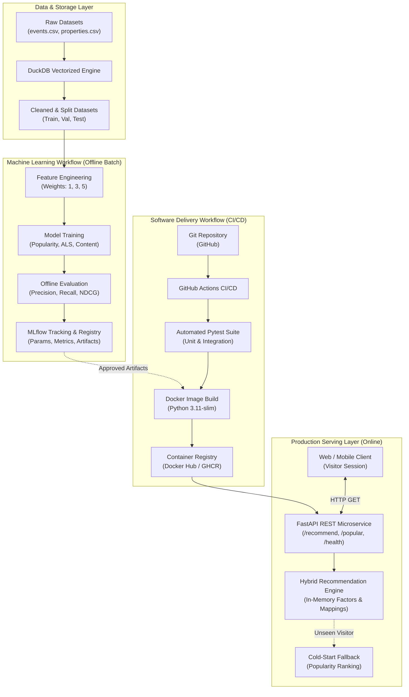
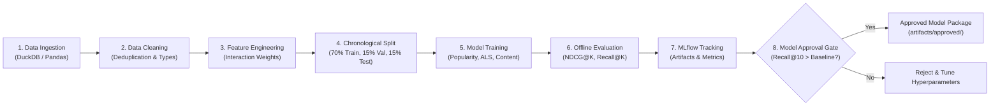
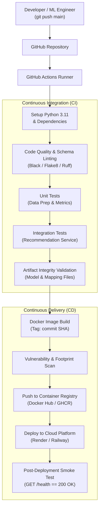
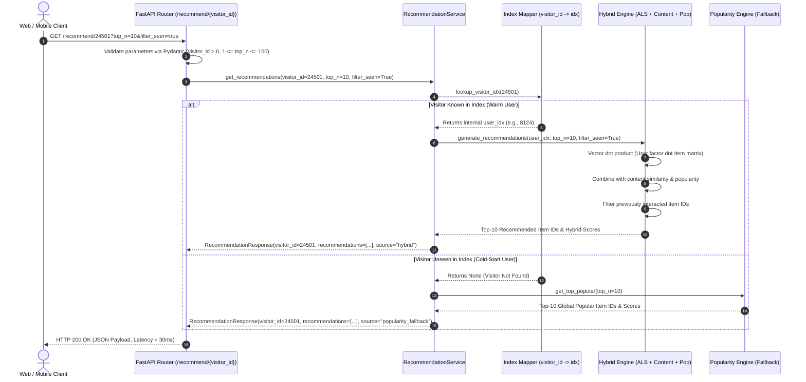

# System Architecture Specification

## 1. Architectural Overview & Design Principles
The **E-Commerce Product Recommendation System** is designed as a decoupled, modular, and cloud-native machine learning service. It addresses the classical impedance mismatch between data science exploration (heterogeneous notebooks, heavy matrix computations) and production software engineering (deterministic APIs, sub-100ms latency budgets, automated testing, and immutable containers).

### Core Architectural Principles:
1. **Decoupled Workflows:** Model training/experimentation is strictly decoupled from real-time API inference. The API serves pre-trained, validated artifacts and never executes ad-hoc training routines during web requests.
2. **Deterministic Fallbacks:** The serving layer implements multi-tiered graceful degradation: Personalized Hybrid $\rightarrow$ Collaborative Filtering $\rightarrow$ Global Popularity Baseline. A customer request never results in an unhandled 500 error or blank UI.
3. **Reproducible Artifact Lineage:** Code, parameters, metrics, and binary weights are tracked through Git and MLflow. No model reaches production without passing an automated ranking quality gate.
4. **Stateless Horizontally Scalable Serving:** The FastAPI serving layer maintains zero persistent session state. Container instances can be horizontally scaled behind an ingress controller or cloud load balancer without synchronization overhead.

---

## 2. High-Level System Architecture



---

## 3. Workflow 1: Machine Learning Workflow

The Machine Learning Workflow operates in an offline/batch lifecycle. It guarantees that models are trained on historical data, evaluated on chronologically future data, and audited before being promoted to deployment.



### Detailed Stage Breakdown:
1. **Data Ingestion:** DuckDB reads raw CSV files (`events.csv`, `category_tree.csv`, `item_properties_part1.csv`, `item_properties_part2.csv`) from disk, using vectorized memory scanning.
2. **Data Cleaning:** Validates critical identifier non-nullity, parses millisecond timestamps into UTC datetimes, removes corrupted events, and filters isolated bots.
3. **Feature Engineering:** Computes implicit interaction weights ($w_{\text{view}}=1.0, w_{\text{addtocart}}=3.0, w_{\text{transaction}}=5.0$) and aggregates interactions at the `(visitorid, itemid)` level.
4. **Chronological Splitting:** Sorts interaction logs temporally. The earliest 70% forms the **Training Set**, the subsequent 15% forms the **Validation Set** (for hyperparameter tuning), and the final 15% forms the **Test Set** (held-out final benchmark).
5. **Model Training:**
   - **Popularity Baseline:** Precomputes global weighted score vectors.
   - **Implicit ALS:** Solves alternating least squares on sparse CSR interaction matrices to obtain user latent matrix $X \in \mathbb{R}^{|U| \times k}$ and item latent matrix $Y \in \mathbb{R}^{|I| \times k}$.
   - **Content-Based:** Computes TF-IDF vector spaces and cosine similarity profiles over anonymized categorical item attributes.
   - **Hybrid Engine:** Tunes fusion weights ($\alpha, \beta, \gamma$) to maximize validation ranking quality.
6. **Offline Evaluation:** Evaluates top-$K$ recommendations across test users for Precision@K, Recall@K, NDCG@K, MAP@K, and Catalog Coverage.
7. **MLflow Tracking:** Logs run metadata, hyperparameter configurations, evaluation metric curves, and serialized artifact files.
8. **Model Approval Gate:** Automated assertion script verifies whether the candidate model outperforms the popularity baseline's Recall@10 by at least 30% without exceeding memory limits.

---

## 4. Workflow 2: Software Delivery Workflow (CI/CD)

The Software Delivery Workflow automates testing, packaging, and cloud deployment, ensuring that no broken code or incompatible artifact reaches production.



### Detailed Stage Breakdown:
1. **Source Control Trigger:** Pushes to the `main` branch or pull requests trigger the GitHub Actions workflow (`.github/workflows/ci-cd.yml`).
2. **Environment Setup:** Provisions an isolated Ubuntu runner with Python 3.11 and installs pinned dependencies from `requirements.txt`.
3. **Automated Testing Suite:**
   - Unit tests verify data preprocessing, weight calculations, and metric formulas against known mathematical ground truth.
   - Integration tests verify the recommendation engine against synthetic interaction matrices.
   - API tests execute asynchronous HTTP GET calls against `/`, `/health`, `/popular`, and `/recommend/{visitor_id}`.
4. **Artifact Validation:** Confirms that model artifact files exist, are uncorrupted, and are compatible with the serving schema.
5. **Container Build:** Compiles the OCI-compliant Docker image using `Dockerfile`, adhering to `.dockerignore` to ensure raw datasets are never baked into container layers.
6. **Cloud Deployment:** Dispatches a deployment webhook to Render / Railway, which pulls the new image and executes a rolling zero-downtime deployment.
7. **Smoke Test:** Runs automated HTTP probes against the live cloud `/health` endpoint to ensure the new version is healthy and serving recommendations.

---

## 5. Serving Runtime Request-Response Architecture

The diagram below illustrates the exact microsecond request lifecycle inside the running container when an e-commerce client queries the API:



---

## 6. Directory Layout & Module Responsibilities

The codebase follows the industry-standard modular package structure:

```
ecommerce-recommendation-mlops/
├── data/
│   ├── raw/                        # Symlink or reference to dataset/ CSVs
│   └── processed/                  # Cleaned events, sparse matrices, splits
├── notebooks/                      # Exploratory & prototyping notebooks
│   ├── 01_data_inspection.ipynb    # Raw schema and nullity profiling
│   ├── 02_data_preparation.ipynb   # Cleaning, deduplication, weights
│   ├── 03_interactive_eda.ipynb    # Interactive Plotly/ipywidgets dashboard
│   ├── 04_popularity_model.ipynb   # Global baseline development
│   ├── 05_collaborative_filtering.ipynb # Implicit ALS factorization
│   ├── 06_content_based_model.ipynb     # TF-IDF attribute similarity
│   └── 07_hybrid_recommendation.ipynb  # Score blending and rank fusion
├── src/                            # Modular production Python package
│   ├── __init__.py
│   ├── data/                       # Ingestion & cleaning logic
│   │   ├── __init__.py
│   │   ├── load_data.py
│   │   └── preprocess.py
│   ├── features/                   # Interaction weighting & matrix building
│   │   ├── __init__.py
│   │   └── build_features.py
│   ├── models/                     # Recommendation model classes
│   │   ├── __init__.py
│   │   ├── popularity.py
│   │   ├── collaborative_filtering.py
│   │   └── content_based.py
│   ├── recommendation/             # Hybrid fusion & cold-start routing
│   │   ├── __init__.py
│   │   └── hybrid.py
│   └── evaluation/                 # Ranking metrics (Precision, Recall, NDCG)
│       ├── __init__.py
│       └── metrics.py
├── app/                            # FastAPI serving application
│   ├── __init__.py
│   ├── main.py                     # ASGI application & route endpoints
│   ├── schemas.py                  # Pydantic request/response schemas
│   └── services.py                 # Singleton inference service loader
├── tests/                          # Automated Pytest suite
│   ├── __init__.py
│   ├── test_api.py                 # Endpoint integration tests
│   ├── test_models.py              # Model training and inference tests
│   └── test_recommendations.py     # Hybrid logic and fallback tests
├── configs/                        # YAML configuration files
│   └── config.yaml                 # Paths, hyperparams, weights, thresholds
├── artifacts/                      # Model weights, index maps, metadata
│   ├── models/
│   └── mappings/
├── docs/                           # Architecture, specs, and reports
│   ├── requirements.md
│   ├── business_problem.md
│   ├── functional_requirements.md
│   ├── non_functional_requirements.md
│   ├── technology_stack.md
│   └── architecture.md
├── .github/
│   └── workflows/
│       └── ci-cd.yml               # GitHub Actions CI/CD automation
├── Dockerfile                      # Production container recipe
├── .dockerignore                   # Exclude datasets, git, caches from build
├── .gitignore                      # Ignore datasets, pycache, artifacts
├── requirements.txt                # Pinned production Python dependencies
└── README.md                       # Comprehensive project documentation
```
