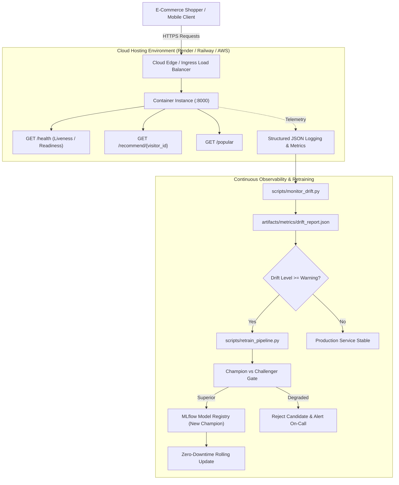

# Phase 8: Production Deployment and Monitoring

## 1. Executive Summary

Phase 8 completes the end-to-end Machine Learning Systems Development Life Cycle (ML-SDLC). It bridges our containerized recommendation API with cloud hosting environments (**Render**, **Railway**, or any OCI-compliant container orchestrator), establishes continuous telemetry for **data drift** and **concept drift**, defines automated **champion-vs-challenger retraining**, and details disaster recovery runbooks.

---

## 2. Production Deployment Architecture

---

## 3. Cloud Manifests & Multi-Cloud Configurations

### 3.1 Render Configuration (`render.yaml`)
Configured in [render.yaml](file:///d:/projects%20&%20datasets/Ecommerce_rcmd_sys/render.yaml):
- **Runtime:** `docker` using production [Dockerfile](file:///d:/projects%20&%20datasets/Ecommerce_rcmd_sys/Dockerfile).
- **Region:** `oregon` (low latency, high availability).
- **Health Check Path:** `/health` (ensures traffic is only routed after ALS and Content models are fully unpickled into RAM).
- **Auto-Deploy:** Enabled on push to `main` following successful CI/CD pipeline completion.

### 3.2 Railway Configuration (`railway.json`)
Configured in [railway.json](file:///d:/projects%20&%20datasets/Ecommerce_rcmd_sys/railway.json):
- **Builder:** `DOCKERFILE`.
- **Healthcheck Timeout:** 15 seconds to accommodate pre-warming.
- **Restart Policy:** `ON_FAILURE` (max 3 retries) with automatic container recycling.

---

## 4. Production Monitoring & Telemetry Architecture

### 4.1 Key Service-Level Indicators (SLIs) & Objectives (SLOs)

| Metric | Target SLA | Warning Threshold | Critical Incident Threshold |
| :--- | :--- | :--- | :--- |
| **P95 Latency** | $< 25.0\text{ ms}$ | $> 50.0\text{ ms}$ | $> 80.0\text{ ms}$ (Degrade to Popularity) |
| **P99 Latency** | $< 50.0\text{ ms}$ | $> 75.0\text{ ms}$ | $> 120.0\text{ ms}$ |
| **Availability / Uptime** | $99.9\%$ | $< 99.5\%$ | $< 99.0\%$ |
| **HTTP 5xx Error Rate** | $< 0.01\%$ | $> 0.1\%$ | $> 1.0\%$ |
| **Memory Footprint (RSS)**| $< 650\text{ MB}$ | $> 800\text{ MB}$ | $> 1000\text{ MB}$ (Trigger restart) |

### 4.2 Data & Concept Drift Monitoring (`scripts/monitor_drift.py`)

Drift analysis runs on a recurring schedule (e.g., daily cron) to compare historical training baseline interactions against recent production windows.

#### 1. Population Stability Index (PSI)
Measures the shift in implicit interaction weights across events:
$$\text{PSI} = \sum_{b=1}^{B} \left( P_b - Q_b \right) \times \ln\left( \frac{P_b}{Q_b} \right)$$
- $\text{PSI} < 0.10$: Distribution is stable; zero drift detected.
- $0.10 \le \text{PSI} < 0.25$: Moderate drift; warning logged to telemetry.
- $\text{PSI} \ge 0.25$: Significant data drift; automated retraining triggered immediately.

#### 2. Cold-Start Vocabulary Drift
Tracks the percentage of inference queries originating from previously unobserved visitor IDs:
$$\text{Cold-Start Ratio} = \frac{N_{\text{unseen visitors}}}{N_{\text{total visitors}}}$$
If the cold-start ratio exceeds $60\%$, an automated retraining job ingests new anonymous cookie mappings.

#### 3. Unindexed Catalog Ratio
$$\text{Catalog Inactivity Ratio} = \frac{N_{\text{new products}}}{N_{\text{catalog}}}$$
If newly added e-commerce items exceed $15\%$ of active inventory, TF-IDF vectors and popularity caches are refreshed.

---

## 5. Automated Retraining Pipeline (`scripts/retrain_pipeline.py`)

### Retraining Triggers
1. **Event-Driven Drift Trigger:** Automatically initiated when `drift_level == "SIGNIFICANT_DRIFT"`.
2. **Calendar Schedule:** Weekly cron job executing every Sunday at 02:00 UTC.
3. **Manual CLI Override:** Force execution via `python scripts/retrain_pipeline.py --force`.

### Challenger vs. Champion Evaluation Gate
1. The pipeline fits candidate models on newly ingested interaction logs.
2. The challenger is evaluated against held-out validation data.
3. **Promotion Rules:**
   - Challenger Recall@10 must match or beat the active champion:
     $$\text{Recall}_{\text{challenger}} \ge 0.99 \times \text{Recall}_{\text{champion}}$$
   - Average inference latency must remain strictly below $80.0\text{ ms}$.
   - All quality checks in `scripts/ci_model_gate.py` must pass.
4. If approved, the challenger replaces `artifacts/approved/` and is registered as the new champion in the MLflow Model Registry.
5. If degraded, the candidate is discarded, leaving the existing champion untouched.

---

## 6. Incident Response & Rollback Runbook

### Scenario A: Service Latency Spike ($> 80\text{ ms}$)
1. **Immediate Mitigating Action:** The FastAPI service automatically flags degraded status and temporarily switches warm traffic to pre-indexed Popularity recommendations (sub-millisecond latency).
2. **Root Cause Analysis:** Inspect container RAM and OpenBLAS thread counts (`OPENBLAS_NUM_THREADS=1`).
3. **Remediation:** If memory fragmentation is observed, trigger container restart.

### Scenario B: Challenger Model Produces Irrelevant Recommendations
1. **Rollback Command:** In MLflow Model Registry, revert model tag `approved_champion` to Version 1 (the baseline champion).
2. **Container Redepoly:** Trigger CI/CD deploy webhook to pull the previous verified image tag `:${PREVIOUS_GIT_SHA}` from `ghcr.io`.
3. **Zero-Downtime Guarantee:** The container orchestrator waits for the new container's `/health` probe to return `200 OK` before terminating the faulty container.
