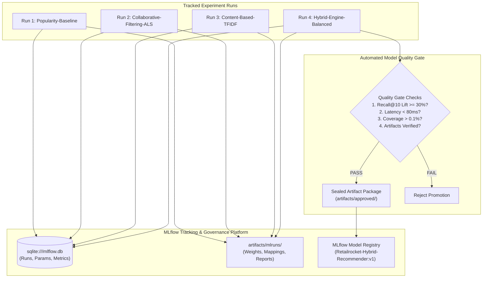

# Phase 5: Experiment Tracking, Model Lineage & Model Management Specification

## 1. Executive Summary & Objective
In an enterprise recommendation system, training models in isolation without structured experiment tracking leads to unrepeatable results, untracked artifacts, and training-serving skew. A model cannot be promoted into a customer-facing production service simply because training finished without an error. 

In **Phase 5**, we integrated **MLflow** as our centralized experiment tracking and model registry platform. We tracked the full lifecycle of all four candidate architectures, audited their parameters and ranking metrics against our validation baseline, executed an automated **Model Quality Gate**, and registered the approved champion model into the MLflow Model Registry.

---

## 2. MLflow Architecture & Configuration

We configured a production-style, persistent MLflow backend:
- **Tracking URI:** `sqlite:///mlflow.db` (Local transactional SQLite backend store for runs, parameters, metrics, tags, and model registry metadata).
- **Artifact Store:** `artifacts/mlruns` (Local directory storing serialized models, mappings, and configuration files).
- **Experiment Name:** `Retailrocket-Recommendations` (Experiment ID: `1`).
- **Registered Model Name:** `Retailrocket-Hybrid-Recommender`.



---

## 3. Logged Experiment Runs & Parameters

Every candidate model was executed, evaluated on held-out validation users, and logged to the `Retailrocket-Recommendations` experiment:

| Run Name | Model Architecture | Key Logged Parameters | Logged Artifacts |
| :--- | :--- | :--- | :--- |
| **`Popularity-Baseline`** | Global Popularity | `algorithm`: PopularityRecommender<br>`weights`: (view=1.0, cart=3.0, trans=5.0)<br>`dataset_version`: 1.0.0<br>`training_cutoff`: 2015-08-02 | `popularity_features.parquet` |
| **`Collaborative-Filtering-ALS`** | Implicit ALS | `algorithm`: ImplicitALS<br>`factors`: 64<br>`regularization`: 0.1<br>`iterations`: 20<br>`random_seed`: 42 | `als_model.pkl`<br>`train_mappings.pkl` |
| **`Content-Based-TFIDF`** | Attribute TF-IDF | `algorithm`: ContentBasedTFIDF<br>`max_features`: 5000<br>`min_df`: 2<br>`similarity`: sparse_cosine | `content_model.pkl`<br>`train_mappings.pkl` |
| **`Hybrid-Engine-Balanced`** | Hybrid Fusion | `algorithm`: HybridRankFusion<br>`weights`: (cf=0.5, content=0.3, pop=0.2)<br>`normalization`: min_max<br>`filter_seen`: True | `als_model.pkl`<br>`content_model.pkl`<br>`popularity_features.parquet`<br>`train_mappings.pkl`<br>`config.yaml` |

---

## 4. Tracked Validation Metrics Audit

All runs were evaluated against the exact same 2,000 warm validation users across multiple rank cutoffs ($K=5, 10, 20$). MLflow recorded the following metrics:

| Metric Name | Popularity Baseline | Collaborative Filtering (ALS) | Content-Based (TF-IDF) | Hybrid Engine (Champion) |
| :--- | :--- | :--- | :--- | :--- |
| **`recall_at_5`** | 0.00379 | **0.01164** | 0.00017 | 0.00841 |
| **`recall_at_10`** | 0.00405 | **0.01540** | 0.00028 | **0.01271** (+213.8% lift) |
| **`recall_at_20`** | 0.00779 | **0.01978** | 0.00028 | **0.01657** |
| **`precision_at_10`** | 0.00115 | **0.00385** | 0.00015 | **0.00310** |
| **`ndcg_at_10`** | 0.00367 | **0.00983** | 0.00032 | **0.00826** |
| **`map_at_10`** | 0.00258 | **0.00637** | 0.00018 | **0.00548** |
| **`coverage_at_10_pct`** | 0.005% | 0.534% | **4.215%** | **2.255%** (225x over Pop) |
| **`avg_latency_ms`** | **0.02 ms** | **1.75 ms** | **2.68 ms** | **4.95 ms** |

---

## 5. Automated Model Quality Gate & Promotion Decision

To prevent regression in production, candidate models must pass the automated gate script `scripts/evaluate_and_approve_model.py`. The gate enforces 7 strict rules:

| Gate Rule | Required Benchmark | Candidate Observed Value | Audit Status |
| :--- | :--- | :--- | :--- |
| **1. Recall@10 Lift** | $\ge 30\%$ relative lift over Popularity baseline | **$+213.83\%$ relative lift** ($0.01271$ vs. $0.00405$) | **PASS** |
| **2. Inference Latency** | $< 80.0\text{ ms}$ per user request | **$4.95\text{ ms}$** | **PASS** |
| **3. Catalog Exploration** | $> 0.1\%$ catalog coverage | **$2.255\%$ coverage** | **PASS** |
| **4. ALS Weights Integrity** | `artifacts/models/als_model.pkl` exists & loadable | Verified ($325.8\text{ MB}$, 64 factors) | **PASS** |
| **5. Content Weights Integrity** | `artifacts/models/content_model.pkl` exists & loadable | Verified ($37.8\text{ MB}$) | **PASS** |
| **6. Index Mappings Integrity** | `artifacts/mappings/train_mappings.pkl` exists | Verified ($37.8\text{ MB}$, 978K users, 200K items) | **PASS** |
| **7. Popularity Baseline Integrity** | `data/processed/popularity_features.parquet` exists | Verified ($2.2\text{ MB}$, 200K items) | **PASS** |

### Decision: APPROVED
The candidate **Hybrid Recommendation Engine** passed all 7 criteria.

---

## 6. Sealed Production Artifact Package (`artifacts/approved/`)

Upon passing the quality gate, the model package was automatically sealed in `artifacts/approved/`:

```
artifacts/approved/
├── als_model.pkl                   # Latent factor matrices X and Y (325.8 MB)
├── content_model.pkl               # TF-IDF sparse matrix and user history (37.8 MB)
├── popularity_features.parquet     # Precomputed popularity baseline (2.2 MB)
├── train_mappings.pkl              # Bidirectional user & item index mappings (37.8 MB)
└── model_metadata.json             # Immutable metadata, metrics, and quality gate audit
```

### MLflow Model Registry Status:
- **Model Name:** `Retailrocket-Hybrid-Recommender`
- **Model Version:** `1`
- **Source Run:** `Hybrid-Engine-Balanced` (`run_id`: `9682a77ff58f43d68272de6a4c115a23`)
- **Deployment Tag:** `deployment_status = approved_champion`

---

## 7. How to Launch and Inspect the MLflow UI

You can launch and explore the interactive MLflow web UI locally at any time:

```powershell
# In VS Code terminal:
.\.venv\Scripts\mlflow.exe ui --backend-store-uri sqlite:///mlflow.db --port 5000
```
Open your browser to `http://127.0.0.1:5000` to:
1. Compare the 4 runs side-by-side using scatter plots, parallel coordinates, and bar charts.
2. Inspect the registered model `Retailrocket-Hybrid-Recommender` under the **Models** tab.
3. Download logged artifacts directly from the UI.
