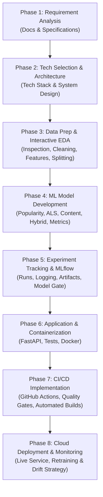

# Master System Requirements Specification (SRS)
## Project: E-Commerce Product Recommendation System with MLOps

---

## 1. Document Control & Metadata
- **Project Name:** E-Commerce Product Recommendation System
- **Dataset:** Retailrocket Recommender System Dataset
- **Methodology:** 8-Phase Machine Learning Software Development Life Cycle (ML-SDLC)
- **Document Version:** 1.0.0
- **Primary Authors:** Senior ML Engineer, Data Scientist, MLOps Architect & Mentee

---

## 2. Project Vision & Scope
The objective of this project is to architect, develop, evaluate, and deploy a production-ready, hybrid e-commerce recommendation system. Operating on implicit customer feedback (views, cart additions, purchases), the system generates low-latency, personalized, and popular recommendations for both authenticated and anonymous shoppers. The system is designed according to modern MLOps principles, featuring reproducible training pipelines, experiment tracking via MLflow, containerized serving with FastAPI, and automated CI/CD deployment.

### In-Scope:
- Processing and cleaning the Retailrocket multi-table behavioral logs.
- Interactive Exploratory Data Analysis (EDA) dashboard in Jupyter.
- Chronological train-validation-test splitting to prevent future data leakage.
- Implementation of four recommendation algorithms:
  1. Popularity-based baseline (global and cold-start fallback).
  2. Collaborative filtering via Implicit Alternating Least Squares (ALS).
  3. Attribute-based content similarity using sparse TF-IDF representations.
  4. Hybrid recommendation engine combining candidate retrieval and score fusion.
- Comprehensive offline evaluation using ranking metrics (Precision@K, Recall@K, NDCG@K, MAP@K, Coverage, Diversity).
- Experiment tracking, parameter logging, and artifact management via MLflow.
- Production-grade FastAPI serving layer with Pydantic schema validation.
- Automated testing suite with Pytest and HTTPX.
- Containerization with Docker.
- CI/CD automation with GitHub Actions.
- Cloud deployment and monitoring strategy.

### Out-of-Scope:
- Natural Language Processing (NLP) on raw text descriptions (item properties are hashed/anonymized in the Retailrocket dataset).
- Deep learning neural collaborative filtering (NCF) or reinforcement learning agents (excessive compute overhead for standard small cloud tiers without significant ranking lift over tuned ALS on this dataset).
- Real-time online multi-armed bandit exploration (reserved for future milestone).

---

## 3. Mathematical Formulations & Success Metrics

### 3.1 Implicit Interaction Weighting
Given customer interaction events $e \in \{\text{view}, \text{addtocart}, \text{transaction}\}$, we assign confidence scores:
$$c_{u,i} = 1 + \alpha r_{u,i}$$
In our calibrated discrete weighting:
$$\text{Weight}(u, i) = \sum_{e \in E_{u,i}} w_e, \quad w_{\text{view}} = 1.0, \; w_{\text{addtocart}} = 3.0, \; w_{\text{transaction}} = 5.0$$

### 3.2 Evaluation Metrics Formulation
For each user $u$ in the test set, let:
- $R_u$: Set of ground-truth relevant items interacted with in the test period.
- $\hat{R}_u(K) = [i_1, i_2, \dots, i_K]$: Top-$K$ ordered recommendations generated by the model.

1. **Precision@K:**
   $$\text{Precision@}K = \frac{|\hat{R}_u(K) \cap R_u|}{K}$$

2. **Recall@K:**
   $$\text{Recall@}K = \frac{|\hat{R}_u(K) \cap R_u|}{|R_u|}$$

3. **Discounted Cumulative Gain (DCG@K) & NDCG@K:**
   $$\text{DCG@}K = \sum_{m=1}^{K} \frac{2^{\mathbb{I}(i_m \in R_u)} - 1}{\log_2(m + 1)}, \quad \text{NDCG@}K = \frac{\text{DCG@}K}{\text{IDCG@}K}$$
   where $\text{IDCG@}K$ is the ideal DCG obtained by placing all true test items at the top ranks.

4. **Mean Average Precision (MAP@K):**
   $$\text{AP@}K = \frac{1}{\min(|R_u|, K)} \sum_{m=1}^{K} \text{Precision@}m \times \mathbb{I}(i_m \in R_u), \quad \text{MAP@}K = \frac{1}{|U_{\text{test}}|} \sum_{u \in U_{\text{test}}} \text{AP@}K(u)$$

5. **Catalog Coverage@K:**
   $$\text{Coverage@}K = \frac{\left|\bigcup_{u \in U_{\text{test}}} \hat{R}_u(K)\right|}{|I_{\text{catalog}}|}$$

---

## 4. Measurable Project Success Criteria

| Evaluation Area | Success Threshold | Measurement Method | Verification Phase |
| :--- | :--- | :--- | :--- |
| **Data Quality Gate** | Zero missing visitor IDs, zero missing product IDs in clean split; zero negative timestamps. | Automated schema assertions in preprocessing pipeline. | Phase 3 |
| **Data Leakage Gate** | Max(Train Timestamp) $\le$ Min(Val Timestamp) $\le$ Min(Test Timestamp). | Temporal split validation assert script. | Phase 3 |
| **Ranking Accuracy (Recall@10)** | Collaborative Filtering (ALS) Recall@10 must outperform Popularity baseline by at least $\ge 30\%$ relative. | Offline evaluation on held-out validation set. | Phase 4 |
| **Ranking Quality (NDCG@10)** | Hybrid Engine NDCG@10 $\ge$ individual component models. | MLflow experiment comparison. | Phase 4 & 5 |
| **API Latency** | $P95 < 80 \text{ ms}$ for $N=10$ recommendations under local benchmark. | Locust / HTTPX benchmark probe. | Phase 6 |
| **Cold-Start Reliability** | $100\%$ valid recommendations returned for unseen visitor IDs (zero HTTP 500 errors). | Pytest test suite covering edge cases. | Phase 6 |
| **Test Suite Coverage** | $\ge 80\%$ test coverage across `src/` and `app/`. | Pytest-cov report during CI. | Phase 6 & 7 |
| **Container Portability** | Standalone Docker build succeeds with image size $< 1.2 \text{ GB}$ and runs cleanly. | Docker build and run verification. | Phase 6 |
| **CI/CD Pipeline** | Automated GitHub Actions workflow executes tests, builds image, and validates artifacts. | GitHub Actions green build badge. | Phase 7 |
| **Live Cloud Deployment** | Publicly accessible REST API returning live predictions for `/health`, `/popular`, and `/recommend/{id}`. | Live HTTP GET request verification. | Phase 8 |

---

## 5. SDLC Phase Traceability Matrix

| Phase | Core Deliverables | Success Gate |
| :--- | :--- | :--- |
| **Phase 1: Requirements** | `docs/requirements.md`, `docs/business_problem.md`, `docs/functional_requirements.md`, `docs/non_functional_requirements.md` | Formal sign-off on scope, metrics, and constraints. |
| **Phase 2: Architecture** | `docs/architecture.md`, `docs/technology_stack.md`, Mermaid diagrams, repository skeleton | Clear system blueprint and verified environment setup. |
| **Phase 3: Data & EDA** | Cleaned datasets, interaction aggregates, temporal splits, `03_interactive_eda.ipynb` | Validated data quality report, zero leakage confirmed. |
| **Phase 4: ML Modeling** | `src/models/` (Popularity, ALS, Content, Hybrid), evaluation script, comparative report | Hybrid model outperforms baseline; metrics logged. |
| **Phase 5: MLflow MLOps** | MLflow experiment runs, logged model artifacts, parameter records, registered model | Model artifact package packaged and approved. |
| **Phase 6: API & Docker** | `app/` (FastAPI routes, schemas, services), `tests/`, `Dockerfile`, `.dockerignore` | All tests pass; Docker container responds locally <80ms. |
| **Phase 7: CI/CD** | `.github/workflows/ci-cd.yml`, quality gate checks, automated runner | Automated build passes cleanly without manual steps. |
| **Phase 8: Deployment** | Live deployment (Render/Railway), monitoring guide, retraining runbook | Verified 200 OK responses from public cloud endpoint. |
